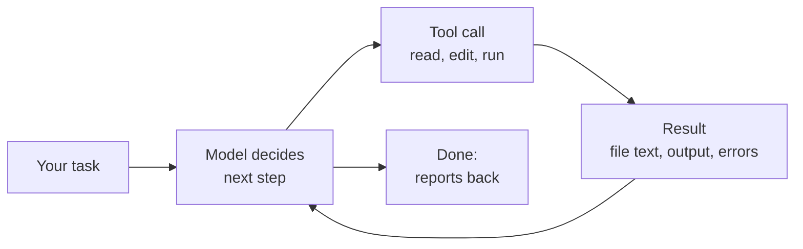

# How coding agents work

 
 
<Link to="toc" title="Table of Contents"/>

---
hideInToc: true
---

# Chat assistant vs. coding agent

| | Chat assistant | Coding agent |
| --- | --- | --- |
| **Sees** | What you paste in | Your repository, files and terminal output |
| **Does** | Suggests code | Edits files, runs commands, runs tests |
| **Checks** | Nothing; you copy and try | Reads errors and tries again |
| **You** | Do the work | Direct and review the work |

The agent in this training is a **coding agent**: a model in a loop with tools, running in your terminal or editor.

<!--
The difference that matters is the loop. A chat assistant answers once. An agent keeps going until it thinks the task is done, using tools along the way.
-->

---
hideInToc: true
---

# The agent loop

- Every step is a **tool call**: read a file, search, edit, run a shell command, fetch a page
- The model only knows what's in its **context**: your prompt, instruction files, and every tool result so far
- It stops when it *believes* the task is done, which isn't the same as *being* done

<!--
This is why verification matters: the agent's "done" is a judgment, not a guarantee. Give it a way to check its own work (tests, a build, a linter) and it gets much better.
-->

---
hideInToc: true
---

# Context is the working memory

- Everything the agent knows this session lives in a fixed-size **context window**
- Long sessions fill it with file contents and command output
- When it fills, the agent **compacts**: summarizes older turns and drops detail
- New session = blank slate, apart from instruction files and memory

**What this means for you**

- One task per session; start fresh for unrelated work
- Point at the files that matter instead of making it search the whole repo
- Put anything it must always know in the **instructions file**, not the chat

---
hideInToc: true
---

# Instruction files

A Markdown file in the repository that every session reads at startup.

- `AGENTS.md` is the most common name; some agents have their own name for it
- There's usually a global one for you, a project one you commit, and optional ones in subdirectories
- The agent's own section shows exactly where it looks

Good content: build and test commands, project layout, conventions, things that look wrong but aren't, what never to touch.

Most agents have an `/init` command that writes a first draft from your repository.

<!--
Keep it short and specific. It's sent with every request, so every line costs context, and vague advice ("write clean code") does nothing.
-->

---
hideInToc: true
---

# Instructions are guidance, not guarantees

- The model reads the file and *usually* follows it
- Long or conflicting instructions get followed less reliably
- Nothing in an instructions file **stops** a command from running

For anything that must hold every time, use the agent's **controls** instead:

- **Permissions** decide which tools and commands run without asking
- **Sandboxes** limit what a command can reach on disk and the network
- **Hooks** run your own scripts before or after tool calls
- **CI and tests** check the result, whoever wrote it

---
hideInToc: true
---

# Permissions and sandboxes

Most agents ask before risky actions, and all of them let you loosen that.

| Level | What happens |
| --- | --- |
| Read-only / plan | Reads and proposes; changes nothing |
| Ask (default) | Edits and commands need your approval |
| Auto-edit | File edits go through; commands still ask |
| Full auto in a sandbox | Runs freely, but only inside the workspace |
| Bypass everything | No prompts, no limits. Disposable VMs and containers only |

Start strict. Loosen per project once you trust the setup, and only allow-list commands you'd run without reading.

<!--
The "bypass" modes have scary names on purpose: --dangerously-skip-permissions, --dangerously-bypass-approvals-and-sandbox, --yolo. They're fine in a throwaway container with no credentials and no network. Never on your laptop with your SSH keys and cloud logins.
-->

---
hideInToc: true
---

# Extending an agent

| Mechanism | What it adds |
| --- | --- |
| **MCP servers** | New tools: Jira, a database, a browser, an internal API |
| **Skills** | Packaged instructions and scripts for one kind of task, loaded when relevant |
| **Subagents** | A separate agent with its own context for a side task (search, review) |
| **Hooks** | Your scripts on agent events: block a command, run a formatter |
| **Custom commands** | Saved prompts you run with `/name` |

Every agent in this deck supports MCP, and most have skills, subagents and hooks too. The details differ, so check the per-agent sections.
