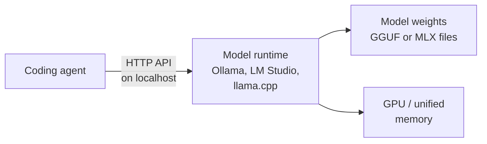

# Running models locally

<br>
<br>
<Link to="toc" title="Table of Contents"/>

---
hideInToc: true
level: 2
---

# Why run a model on your own machine

<div class="grid grid-cols-2 gap-8">

<div>

### What you gain

- **Privacy**: code and prompts never leave the machine
- **Works offline**: on a plane, on an air-gapped network
- **No per-token bill**: you pay once, in hardware
- **Control**: pin a model version; it never changes under you

</div>

<div>

### What you give up

- **Quality**: local models are well behind frontier models on long, multi-step agent work
- **Speed**: tokens per second depend on your GPU and memory
- **Context**: long contexts cost memory you may not have
- **Your time**: you choose, size and update the models

</div>

</div>

A good fit for questions, small edits and sensitive code. Use a frontier model for large refactors.

---
hideInToc: true
level: 2
---

# How the pieces fit



- The agent doesn't change. It talks to an **OpenAI-compatible API** on `localhost` instead of a cloud provider
- The **runtime** loads the weights into memory and serves the API
- The **model** is a file you download once: billions of numbers, compressed to fit

The agent loop, instruction files and permissions all work the same way as before.

---
hideInToc: true
level: 2
class: compact-table
---

# Will it fit? Size by memory

A model's weights have to fit in GPU memory (or a Mac's unified memory), **plus** room for the context.

| Your machine | Model size (4-bit) | What to expect |
| --- | --- | --- |
| 16 GB Mac / 8–12 GB GPU | up to ~8B, or a 20B mixture-of-experts | Questions and small edits |
| 32 GB Mac / 24 GB GPU | 20–32B | Usable for everyday agent work |
| 64 GB+ Mac / 48 GB+ GPU | 70B+, large mixture-of-experts | The best local results |

- Rule of thumb at 4-bit: **about 0.6 GB per billion parameters**, so a 30B model is ~18 GB
- A Mac lets the GPU use roughly two-thirds to three-quarters of its RAM by default
- **Mixture-of-experts** (MoE) models only run a few billion parameters per token: big-model knowledge, small-model speed, but they still need memory for all of it

---
hideInToc: true
level: 2
---

# Quantization and file formats

**Quantization** stores each weight in fewer bits, trading a little quality for a lot of memory.

| Tag | Bits per weight | Notes |
| --- | --- | --- |
| `Q8_0` | 8 | Nearly lossless; twice the memory of 4-bit |
| `Q4_K_M` | ~4.5 | The usual default: a good balance |
| `Q2`, `Q3` | 2–3 | Fits more, but agents start making mistakes |

- **GGUF**: one file per model; used by llama.cpp, Ollama and LM Studio, on any platform
- **MLX**: Apple's format for Apple Silicon; often faster on a Mac. LM Studio runs both
- Agents need **tool calling**: pick models that list "tools" support

---
hideInToc: true
level: 2
class: compact-table
---

# Choosing a runtime

| Runtime | Best for | API endpoint |
| --- | --- | --- |
| **Ollama** | The simplest start; CLI and background service | `http://localhost:11434/v1` |
| **LM Studio** | A desktop app for browsing and testing models; MLX on Mac | `http://localhost:1234/v1` |
| **llama.cpp** | The engine under many others; the most control | `http://localhost:8080/v1` |
| **Docker Model Runner** | Teams already on Docker; models pulled like images | Through Docker Desktop |

All of them run on macOS, Linux and Windows, and all serve an OpenAI-compatible API, so any agent that accepts a custom base URL can use any of them.

This section uses **Ollama**.

---
hideInToc: true
level: 2
class: compact-table
---

# Install Ollama

| Platform | How |
| --- | --- |
| macOS | Download the app from **ollama.com/download**, or `brew install ollama` |
| Linux | `curl -fsSL https://ollama.com/install.sh \| sh` (installs a systemd service) |
| Windows | Download the installer from **ollama.com/download**, or `winget install Ollama.Ollama` |

```bash
ollama --version

# Homebrew only: start the server in the background
brew services start ollama
```

The desktop app and the Linux installer start the server for you. It listens on `localhost:11434`.

---
hideInToc: true
level: 2
---

# Your first local model

```bash
ollama pull gpt-oss:20b       # download once (~14 GB)
ollama run gpt-oss:20b        # chat in the terminal; /bye to exit

ollama list                   # what's downloaded
ollama ps                     # what's loaded, and whether it's on the GPU
ollama rm gpt-oss:20b         # free the disk space
```

Call it the way an agent would:

```bash
curl http://localhost:11434/v1/chat/completions \
  -H "Content-Type: application/json" \
  -d '{"model": "gpt-oss:20b",
       "messages": [{"role": "user", "content": "Say hello"}]}'
```

If `ollama ps` shows **CPU** rather than **GPU**, the model doesn't fit. Choose a smaller one.

---
hideInToc: true
level: 2
---

# Context length: the setting that matters most

A coding agent's system prompt and tool definitions alone can fill **10,000+ tokens** before your task starts.

- Ollama's default context is small. Requests that don't fit are **silently truncated**: the agent forgets its instructions and makes broken tool calls
- Set it explicitly for agent work: **32K at minimum, 64K if you have the memory**
- A larger context uses more memory, so check `ollama ps` again afterwards

```bash
# Command line / Homebrew
OLLAMA_CONTEXT_LENGTH=65536 ollama serve

# Linux service: sudo systemctl edit ollama, then add
#   [Service]
#   Environment="OLLAMA_CONTEXT_LENGTH=65536"
```

In the desktop app: **Settings → Context length**.

---
hideInToc: true
level: 2
class: compact-table
---

# Models for coding agents

| Memory | Try | Why |
| --- | --- | --- |
| 16 GB | `gpt-oss:20b` | MoE, fast, reliable tool calls |
| 24–32 GB | `qwen3-coder:30b` | MoE trained for agentic coding, long context |
| 24–32 GB | `devstral` | Trained specifically to drive coding agents |
| 64 GB+ | `gpt-oss:120b`, `qwen3-coder-next` | The closest you'll get to a hosted model |

- Check **ollama.com/library** for current tags; this list goes out of date fast
- Test two models on **your own** tasks; benchmark rankings rarely match day-to-day use

<!--
This slide dates fastest of anything in the deck. Before each delivery, check the Ollama library and update the tags and memory figures.
-->

---
hideInToc: true
level: 2
---

# Connect an agent: `ollama launch`

Ollama can configure and start several coding agents against a local model in one step:

```bash
ollama launch                                      # pick an agent from a list
ollama launch claude --model qwen3-coder:30b       # Claude Code
ollama launch codex --model gpt-oss:20b            # Codex
ollama launch opencode --model qwen3-coder:30b     # OpenCode

ollama launch opencode --config                    # write the config, don't start
```

- Needs Ollama **0.15 or later**, and the agent already installed
- It sets the agent's base URL and model for you: no API keys, no config files to edit
- Run `ollama launch` with no arguments to see which agents your version supports

---
hideInToc: true
level: 2
---

# Connect an agent by hand

Any agent that accepts an OpenAI-compatible base URL works. OpenCode, in `opencode.json`:

```json
{
  "$schema": "https://opencode.ai/config.json",
  "provider": {
    "ollama": {
      "npm": "@ai-sdk/openai-compatible",
      "name": "Ollama (local)",
      "options": { "baseURL": "http://localhost:11434/v1" },
      "models": { "qwen3-coder:30b": { "name": "Qwen3 Coder 30B" } }
    }
  }
}
```

- **Pi**: Ollama is one of its built-in providers; choose it in `/model`
- **LM Studio** or **llama.cpp**: the same config, with their port in the base URL
- Then use `/models` (or your agent's equivalent) to select the local model

---
hideInToc: true
level: 2
---

# The same with LM Studio

LM Studio is a desktop app (from **lmstudio.ai**) that includes the `lms` command line tool:

```bash
lms get qwen3-coder-30b        # search for and download a model
lms load qwen3-coder-30b \
  --context-length 65536       # load it with an agent-sized context
lms server start               # serve on http://localhost:1234/v1
lms ps                         # what's loaded
```

- On Apple Silicon, choose the **MLX** download when one is offered; it's usually faster
- The app lets you compare models side by side before you give one to an agent

---
hideInToc: true
level: 2
---

# Local doesn't mean safe

A local model keeps your **data** on the machine. It doesn't change what the **agent** can do.

- The agent still runs shell commands and edits files with **your** permissions
- Smaller models make **more mistakes**: wrong files, bad commands, made-up APIs. Tighten your permission rules, don't relax them
- Every trust layer still applies: allow lists, sandboxes, and gates on the remote
- A model file is something you choose to trust, like a dependency. Download models from the runtime's own library or from publishers you recognize
- Keep the server on `localhost`. Ollama and LM Studio have no authentication by default

---
hideInToc: true
level: 2
---

# Getting good results from a local model

- **Smaller tasks**: one file, one function, one test at a time
- **Read the plan first**: use plan mode, or ask for a plan before the change
- **Shorter instruction files**: every line uses up context
- **Verify more**: run the tests and read the diff every time
- **Mix and match**: a local model for routine and sensitive work, a hosted model for the hard problems

If the agent loops, forgets the task or calls tools wrongly, check the **context length** first, then try a bigger model.
