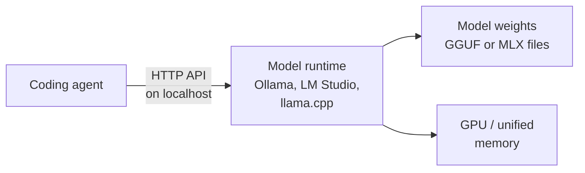

# Running models locally

<br>
<br>
<Link to="toc" title="Table of Contents"/>

---
hideInToc: true
level: 2
---

# Why run a model on your own machine

<div class="grid grid-cols-2 gap-8">

<div>

### What you gain

- **Privacy**: code and prompts never leave the machine
- **Works offline**: on a plane, on an air-gapped network
- **No per-token bill**: you pay once, in hardware
- **Control**: pin a model version; it never changes under you

</div>

<div>

### What you give up

- **Quality**: local models are well behind frontier models on long, multi-step agent work
- **Speed**: tokens per second depend on your GPU and memory
- **Context**: long contexts cost memory you may not have
- **Your time**: you choose, size and update the models

</div>

</div>

A good fit for questions, small edits and sensitive code. Use a frontier model for large refactors.

---
hideInToc: true
level: 2
---

# Buy, rent, or both?

- **More memory often buys the same model**, with more bits and more context, not a smarter one. Check what the next tier actually runs before you pay for it
- **Owning is priced by total parameters, renting by active ones.** A big mixture-of-experts model needs a lot of memory to own but does little work per token, so it's cheap to rent through an API
- **Rent first.** Use the model you're considering through an API for a week, with non-sensitive work, before you buy hardware for it
- **Compare side by side.** Run five real prompts locally and on a hosted frontier model. That tells you which jobs the local model is good enough for

Owning pays off for **compliance** (the data can't leave), **scale** (many agents in parallel, each with its own context in memory) and **control** (fine-tuning, and nobody can retire the model).

<!--
Source: two videos comparing hardware tiers from 8 GB GPUs to 1 TB of unified memory. In their figures, several memory doublings ran the same model at higher precision with no change in benchmark score, and a large MoE model that needs 128 GB to own cost about a twentieth as much per token to rent as a 27B dense model. Prices change weekly; check before quoting.
-->

---
hideInToc: true
level: 2
---

# How the pieces fit



- The agent doesn't change. It talks to an **OpenAI-compatible API** on `localhost` instead of a cloud provider
- The **runtime** loads the weights into memory and serves the API
- The **model** is a file you download once: billions of numbers, compressed to fit

The agent loop, instruction files and permissions all work the same way as before.

---
hideInToc: true
level: 2
class: compact-table
---

# Will it fit? Size by memory

A model's weights have to fit in GPU memory (or a Mac's unified memory), **plus** room for the context.

| Your machine | Model size (4-bit) | What to expect |
| --- | --- | --- |
| 16 GB Mac / 8–12 GB GPU | up to ~8B, or a 20B mixture-of-experts | Questions and small edits |
| 32 GB Mac / 24 GB GPU | 20–32B | Usable for everyday agent work |
| 64 GB+ Mac / 48 GB+ GPU | 70B+, large mixture-of-experts | The best local results |

- Rule of thumb at 4-bit: **about 0.6 GB per billion parameters**, so a 30B model is ~18 GB
- **Context costs memory too**: on an 8 GB GPU, `qwen3:8b` fits at a 4K context (5.6 GB), but at 32K it needs 10 GB and spills onto the CPU
- **The desktop takes its share**: 1–2 GB of VRAM on Windows, so a 16.5 GB file doesn't fit a 16 GB card
- A Mac gives the GPU about **¾ of its RAM**. `sudo sysctl iogpu.wired_limit_mb=<MB>` raises that until the next reboot

---
hideInToc: true
level: 2
---

# The box, the engine and the numbers

Download pages mix up three different kinds of thing:

| Kind | What it is | Examples |
| --- | --- | --- |
| **File format** (the box) | How the weights are packaged | GGUF: one file that runs almost anywhere |
| **Engine** | The software that runs them | llama.cpp (inside Ollama and LM Studio), MLX on Apple Silicon, vLLM on NVIDIA servers |
| **Number format** (what's inside) | How each weight is written down | `Q8_0`, `Q6_K`, `Q4_K_M`, `IQ3`, MLX 4-bit, NVFP4 |

"GGUF or NVFP4?" is like asking "the box or what's in it?" NVFP4 can sit inside a GGUF file, and a "4-bit" MLX download is a folder of weights for the MLX engine. Pick the engine for your chip first, then the numbers.

Agents need **tool calling**, too: pick models that list "tools" support.

---
hideInToc: true
level: 2
class: compact-table
---

# Quantization: fewer bits per weight

**Quantization** stores each weight in fewer bits, trading a little quality for a lot of memory.

| Format | Bits per weight | Notes |
| --- | --- | --- |
| `Q8_0` | ~8.5 | Nearly lossless; almost twice the size of 4-bit |
| `Q6_K` | ~6.6 | Nearly as good as `Q8_0`, with more room for context |
| `Q4_K_M` | ~4.9 | The usual default; sensitive layers are kept at 6 bits |
| MLX 4-bit, NVFP4 | ~4.5 | NVFP4 is only fast on NVIDIA RTX 50 (Blackwell) hardware |
| `IQ3`, `Q3` | ~3–3.7 | Fits more, but agents start making mistakes |

- **Labels name the smallest part, not the average.** An "NVFP4" build of a 27B model was 22 GB against 16.5 GB for `Q4_K_M`, because its attention layers stayed at 8 bits
- **Who did the rounding matters more than the label.** Two "NVFP4" files of one model were 8.8 GB apart and scored differently. Prefer calibrated builds from the model's maker, or from teams that publish benchmarks

---
hideInToc: true
level: 2
class: compact-table
---

# Choosing a runtime

| Runtime | Best for | API endpoint |
| --- | --- | --- |
| **Ollama** | The simplest start; CLI and background service | `http://localhost:11434/v1` |
| **LM Studio** | A desktop app for browsing and testing models; MLX on Mac | `http://localhost:1234/v1` |
| **llama.cpp** | The engine under many others; the most control | `http://localhost:8080/v1` |
| **Docker Model Runner** | Teams already on Docker; models pulled like images | Through Docker Desktop |

All of them run on macOS, Linux and Windows, and all serve an OpenAI-compatible API, so any agent that accepts a custom base URL can use any of them.

This section uses **Ollama**.

---
hideInToc: true
level: 2
class: compact-table
---

# Install Ollama

| Platform | How |
| --- | --- |
| macOS | Download the app from **ollama.com/download**, or `brew install ollama` |
| Linux | `curl -fsSL https://ollama.com/install.sh \| sh` (installs a systemd service) |
| Windows | Download the installer from **ollama.com/download**, or `winget install Ollama.Ollama` |

```bash
ollama --version

# Homebrew only: start the server in the background
brew services start ollama
```

The desktop app and the Linux installer start the server for you. It listens on `localhost:11434`.

On Linux with an NVIDIA card, install the NVIDIA driver first and check that `nvidia-smi` works. Without it, Ollama runs on the CPU.

---
hideInToc: true
level: 2
---

# Your first local model

```bash
ollama pull gpt-oss:20b       # download once (13 GB)
ollama run gpt-oss:20b        # chat in the terminal; /bye to exit

ollama list                   # what's downloaded
ollama ps                     # what's loaded: GPU vs CPU, and the context
ollama rm gpt-oss:20b         # free the disk space
```

Call it the way an agent would:

```bash
curl http://localhost:11434/v1/chat/completions \
  -H "Content-Type: application/json" \
  -d '{"model": "gpt-oss:20b",
       "messages": [{"role": "user", "content": "Say hello"}]}'
```

If `ollama ps` shows a split such as **`15%/85% CPU/GPU`**, the model doesn't fit in GPU memory. It still works, but more slowly.

---
hideInToc: true
level: 2
---

# Context length: the setting that matters most

A coding agent's system prompt and tool definitions alone can fill **10,000+ tokens** before your task starts.

- Ollama defaults to **4K under 24 GB of VRAM** (32K up to 48 GB). Longer prompts are **silently truncated**: in testing, OpenCode's 8,569-token prompt was cut to 2,050, and the agent wrote to a made-up path and then reported success
- Set it explicitly for agent work: **32K at minimum, 64K if you have the memory**
- Check the **CONTEXT** column in `ollama ps`, and whether the model still fits on the GPU

```bash
# Command line / Homebrew
OLLAMA_CONTEXT_LENGTH=65536 ollama serve

# Linux service: sudo systemctl edit ollama, add these lines, then restart
#   [Service]
#   Environment="OLLAMA_CONTEXT_LENGTH=65536"
sudo systemctl restart ollama
```

In the desktop app: **Settings → Context length**.

---
hideInToc: true
level: 2
class: compact-table
---

# Make the context fit on the GPU

The context's working memory (the **KV cache**) can be compressed, like the weights. Measured with `qwen3:8b` on an 8 GB RTX 3060 Ti:

| Context | Settings | Where it runs | Speed |
| --- | --- | --- | --- |
| 4K | defaults | 100% GPU | 75 tok/s, but too small for an agent |
| 32K | defaults | 34% CPU / 66% GPU | 13 tok/s |
| 32K | flash attention, `q8_0` cache | 15% CPU / 85% GPU | 29 tok/s |
| 32K | flash attention, `q4_0` cache | **100% GPU** | **67 tok/s** |

```bash
OLLAMA_FLASH_ATTENTION=1 OLLAMA_KV_CACHE_TYPE=q8_0 ollama serve   # or q4_0 to fit more
```

Prefer `q8_0` if it fits; `q4_0` costs a little more accuracy. The OpenCode task passed 3 of 3 runs with `q4_0`. Some models lose more from a compressed cache than others, so test yours.

---
hideInToc: true
level: 2
class: compact-table
---

# When it doesn't fit: dense vs mixture-of-experts

Measured on the 8 GB RTX 3060 Ti with 61 GB of system RAM, 8K context:

| Model | Kind | File | Where it runs | Speed |
| --- | --- | --- | --- | --- |
| `qwen3:8b` | dense | 5.2 GB | 100% GPU | 75 tok/s |
| `qwen3:14b` | dense | 9.3 GB | 31% CPU / 69% GPU | **10 tok/s** |
| `qwen3-coder:30b` | MoE, ~3B active | 18 GB | experts in system RAM | **28 tok/s** |

- A **dense** model reads every weight for every token. Spill a third into system RAM (~50 GB/s, against 448 GB/s on the card) and everything waits on it
- A **mixture-of-experts** model only reads its few active experts per token, so they can live in system RAM. The 18 GB model was nearly 3× faster than the 9.3 GB one
- On a small GPU, **system RAM is the spec to check**: the MoE model needs its full size free there
- Ollama handled it automatically. In llama.cpp, `--cpu-moe` keeps all experts in RAM (23 tok/s using 2 GB of VRAM); `--n-cpu-moe N` keeps only the first N layers' experts there

---
hideInToc: true
level: 2
---

# Reading is compute, writing is memory

A model works in two phases with different limits:

- **Reading the prompt** handles all its tokens at once, so it's limited by the GPU's **compute**. Measured: a 7,000-token prompt in 2.4 s on the 3060 Ti
- **Writing the answer** reads every weight from memory for **each** token, so it's limited by **memory bandwidth**: tokens/s ≈ bandwidth ÷ bytes read per token (the whole file, or only the active experts for MoE). 448 GB/s ÷ 5.2 GB ≈ 86 tok/s at most; measured 58–75
- A **smaller file writes faster**. A faster number format, like NVFP4 on RTX 50 cards, mostly **reads** faster
- Agents send long prompts every turn, so reading speed matters more for agents than for chat
- Local runtimes cache prompts too: sending the same 7,000-token prompt again took **0 s** to read

If it barely fits, drop to a smaller quantization before you shrink the context. A 3-bit model with room to work beats a 4-bit model that runs out.

---
hideInToc: true
level: 2
class: compact-table
---

# Which file should you download?

Answer three questions, in order:

| Question | Answer |
| --- | --- |
| **1. Which engine runs on your chip?** | **Apple Silicon Mac**: an MLX build, in LM Studio or Ollama's MLX engine (preview). **NVIDIA RTX 30/40, AMD, Intel, CPU**: a GGUF `Q4_K_M`. **RTX 50**: GGUF for chat; NVFP4 on vLLM or SGLang for long prompts and agents |
| **2. Who did the rounding?** | The model's maker, or a known team that publishes benchmarks. Avoid flat conversions from unknown accounts |
| **3. What's left for the conversation?** | Model file plus context must fit in GPU memory. Check `ollama ps` for 100% GPU at the context you need |

**Trap**: an NVFP4 GGUF in plain llama.cpp on a Mac runs on the CPU, at about 1 token/s.

<!--
Source: a video explaining quantization formats, with figures from several community benchmarks. Ollama's own MLX benchmark went from 58 to 112 tok/s, but that compared its old engine with Q4_K_M against the MLX engine with NVFP4. The video reports the plain MLX 4-bit build on the same engine was faster still (134 tok/s): the speed-up came from the engine, not from NVFP4. Ollama ships NVFP4 for quality and to match hosted services. NVFP4 kernels are changing fast, so re-check numbers before each delivery.
-->

---
hideInToc: true
level: 2
---

# Thinking models need room to finish

Many models write a private draft (**thinking**) before they answer, and every token of it uses context.

- Measured: `qwen3:8b` on a hard math question **at 4K** thought for 13,000 tokens. Ollama dropped the oldest half of the context, **including the question**, and the model solved a problem it made up. **At 32K** it answered the real question
- With a token limit instead, the thinking uses it all up and the **answer comes back blank**, with no error
- Give thinking models **16K at the very least**; agents need 32K anyway
- **Count minutes per task, not tokens per second**: 20,000 thinking tokens at 4 tok/s is 80 minutes before the first line of output. A fast model that rambles can lose to a slower one that gets to the point

```bash
ollama run qwen3:8b --think=false     # or low / medium / high on models that support it
ollama run qwen3:8b --hidethinking    # think, but only show the answer
```

<!--
The log line for the dropped context is "slot context shift" in the Ollama server log. Source for blank answers: an independent test of community builds of one 27B model found 15-45% of answers never finished thinking within a 15K-token budget; at 8K, the best build truncated 48%.
-->

---
hideInToc: true
level: 2
class: compact-table
---

# Models for coding agents

| Memory | Try | Why |
| --- | --- | --- |
| 8 GB | `qwen3.5:4b` | Small, with tool use (~6 GB) |
| 16 GB | `gpt-oss:20b`, `gemma4:12b` | Fast, reliable tool calls |
| 24–32 GB | `qwen3-coder:30b`, `devstral` | Trained for agentic coding |
| 32 GB+ | `qwen3.8:27b` | Coding and long agentic tasks (~28 GB) |
| 64 GB+ | `gpt-oss:120b`, `qwen3-coder-next` | The closest you'll get to a hosted model |

- `ollama launch` lists Ollama's current recommendations; this table goes out of date fast
- Test two models on **your own** tasks; benchmark rankings rarely match day-to-day use

<!--
This slide dates fastest of anything in the deck. Before each delivery, check the Ollama library and update the tags and memory figures.
-->

---
hideInToc: true
level: 2
---

# Choosing a community build: test, don't trust

Beyond the official library there are thousands of community builds of each model. What their pages advertise is rarely what matters.

- **Downloads measure visibility, not quality.** In one test of 23 builds of the same model, the most downloaded was the most damaged: 21 points worse at math
- **Check the base model.** Names get misused: a "DeepSeek" 9B going around is really a fine-tuned Qwen
- **Check the chat template.** It wraps every message, and a custom one can change behavior more than 4-bit quantization does
- **Check the file size, not just the label.** Two "Q4" files of one model differed by 1 GB, and that gigabyte comes out of your context

**Run 20 of your own prompts and count the answers that never arrive.** Then raise the context and run them again: if the blanks go away it was the budget, if not it's the model.

---
hideInToc: true
level: 2
---

# Connect an agent: `ollama launch`

Ollama configures and starts a coding agent against a local model:

```bash
ollama launch                                      # pick an agent and model
ollama launch claude --model qwen3-coder:30b       # Claude Code
ollama launch opencode --model qwen3-coder:30b     # OpenCode
ollama launch pi --model qwen3-coder:30b           # Pi; also codex, copilot...
```

- Needs Ollama **0.15 or later**, and the agent already installed. `ollama launch --help` lists the agents
- It opens a model picker with your `--model` preselected; press Enter, then confirm
- Start the agent with `ollama launch` each time. It doesn't write a config file the agent can use on its own
- **Models ending in `:cloud` run on Ollama's servers, not yours.** The picker lists them first

---
hideInToc: true
level: 2
---

# Connect an agent by hand

Any agent that accepts an OpenAI-compatible base URL works. OpenCode, in `opencode.json`:

```json
{
  "$schema": "https://opencode.ai/config.json",
  "provider": {
    "ollama": {
      "npm": "@ai-sdk/openai-compatible",
      "name": "Ollama (local)",
      "options": { "baseURL": "http://localhost:11434/v1" },
      "models": { "qwen3-coder:30b": { "name": "Qwen3 Coder 30B" } }
    }
  }
}
```

- Check it with `opencode models ollama`, then select the model with `/models`
- **LM Studio** or **llama.cpp**: the same config, with their port in the base URL

---
hideInToc: true
level: 2
---

# The same with LM Studio

A desktop app from **lmstudio.ai**, with the `lms` command line tool:

```bash
curl -fsSL https://lmstudio.ai/install.sh | sh  # headless, for servers
lms get qwen3-8b --yes                       # picks a build that fits your GPU
lms load qwen/qwen3-8b -c 32768 \
  --estimate-only                            # how much memory will it need?
lms load qwen/qwen3-8b -c 32768              # load with an agent-sized context
lms server start                             # serve on http://localhost:1234/v1
lms ps                                       # what's loaded, and its context
```

- Skip `lms load` and the API loads the model on first use, with only an **8K** context
- If loading fails with "failed to allocate buffer for kv cache", add `--gpu 0.8` to keep part of the model on the CPU
- On Apple Silicon, choose the **MLX** download when one is offered; it's usually faster

---
hideInToc: true
level: 2
---

# Run the model in a container

On Linux, install the NVIDIA driver and the **NVIDIA Container Toolkit**, then:

```bash
sudo nvidia-ctk runtime configure --runtime=docker && sudo systemctl restart docker
docker run --rm --gpus all ubuntu nvidia-smi      # can a container see the GPU?

docker run -d --name ollama --gpus=all \
  -v ollama:/root/.ollama -p 11434:11434 \
  -e OLLAMA_CONTEXT_LENGTH=32768 \
  -e OLLAMA_FLASH_ATTENTION=1 -e OLLAMA_KV_CACHE_TYPE=q8_0 \
  ollama/ollama
docker exec ollama ollama pull qwen3:8b
```

- **Forget `--gpus` and it still works, on the CPU**: 6 tok/s instead of 75, with no error
- The `ollama` volume keeps downloaded models when the container is replaced
- On a Mac, Docker Desktop and Apple's `container` can't give a container the GPU. Run Ollama natively there

---
hideInToc: true
level: 2
---

# Is the GPU doing the work?

```bash
docker logs ollama | grep "inference compute"    # library=CUDA, not library=cpu
docker exec ollama ollama ps                     # PROCESSOR: 100% GPU
nvidia-smi                                       # memory used, and GPU-Util
nvidia-smi dmon -s um                            # live, every second: sm = busy %, fb = MB used
```

- **Aim for 100% GPU** in `ollama ps`. Any CPU share slows every token, not just a few
- **GPU-Util near 100%** while it generates means the GPU is the limit, which is what you want
- **Free the VRAM**: a second loaded model, LM Studio or a desktop session all take memory. `ollama stop <model>` unloads one
- If it still doesn't fit: shrink the KV cache, then the context, then pick a smaller model

---
hideInToc: true
level: 2
---

# Local doesn't mean safe

A local model keeps your **data** on the machine. It doesn't change what the **agent** can do.

- The agent still runs shell commands and edits files with **your** permissions
- Smaller models make **more mistakes**: wrong files, bad commands, made-up APIs. Tighten your permission rules, don't relax them
- Every trust layer still applies: allow lists, sandboxes, and gates on the remote
- A model file is something you choose to trust, like a dependency. Download models from the runtime's own library or from publishers you recognize
- **"Uncensored" builds** have refusals edited out, and **truthfulness goes first**: up to 14 points lost in one test. A confidently wrong answer is worse than a refusal
- Keep the server on `localhost`. Ollama and LM Studio have no authentication by default

<!--
Source for the community-build figures on these slides: a video walking through an independent benchmark of eight "uncensored" builds of one 27B model (13 tasks plus 400 HarmBench prompts, 167 GPU hours), and 23 builds of a small model. Refusals were near zero for most builds; the differences were in unfinished answers and truthfulness. Check your organization's policy before using modified models.
-->

---
hideInToc: true
level: 2
---

# Getting good results from a local model

- **Smaller tasks**: one file, one function, one test at a time
- **Read the plan first**: use plan mode, or ask for a plan before the change
- **Shorter instruction files**: every line uses up context
- **Verify more**: run the tests and read the diff every time
- **Mix and match**: a local model for routine and sensitive work, a hosted model for the hard problems

If the agent loops, forgets the task or calls tools wrongly, check the **context length** first, then try a bigger model.
