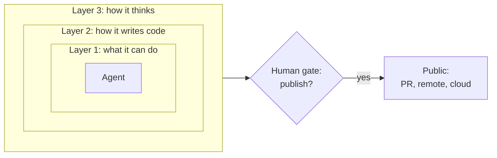
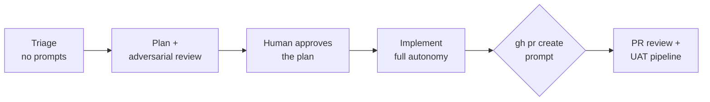

# Agent trust is a system design problem

 
 
<Link to="toc" title="Table of Contents"/>

---
hideInToc: true
level: 2
---

# The approval-fatigue trap

- Twenty permission prompts in ten minutes, and you start approving without reading
- Within an hour most people turn on "always allow"
- The usual fix is **containment**: a sandbox, a container, a devbox

> A contained agent "can still produce bad code, skip steps, and drift from your architecture. It just can't delete your files while doing it."

Containment limits the damage. It doesn't make the work good.

<!--
Source for this whole section: Paul Stack, "Agent Trust Is a System Design Problem", 23 April 2026, https://stack72.dev/agent-trust-is-a-system-design-problem/
His examples use one agent's settings, but the model is agent-neutral. The next section shows it in this agent's own configuration.
-->

---
hideInToc: true
level: 2
---

# Three layers of trust

---
hideInToc: true
level: 2
---

# What each layer controls

| Layer | Controls | Lives in |
| --- | --- | --- |
| **1. Tool permissions** | What the agent can do | The agent's permission settings |
| **2. Project conventions** | How it writes code | The instructions file (`AGENTS.md` or your agent's equivalent) |
| **3. Context and constraints** | How it thinks about problems | Design docs, stage checklists, skills |

---
hideInToc: true
level: 2
---

# Layer 1: allow or ask?

One question decides it:

> Can the action be undone with `git checkout`? **Allow it.**
> Does it affect something outside the local working tree, like a remote, a PR, a cloud resource, or a directory tree? **Ask.**

| Ask about | Examples |
| --- | --- |
| Destruction | `git push --force`, `git reset --hard`, `git clean -f`, `git branch -D`, `rm -rf`, `sudo` |
| Publication | `gh pr create`, `gh pr merge`, `gh issue close` |
| Infrastructure | `aws`, `gcloud`, `az` |
| Wildcards | `gh api` (anything the token allows) |

Everything else (reading, editing, building, testing, read-only `gh`) runs without a prompt.

<!--
Paul's allow list is deliberately broad, including unscoped shell. His own advice for newcomers: start with scoped shell commands and widen them as you learn what the agent actually needs.
The gh pr create prompt exists because a teammate's agent opened a PR nobody approved, which would have shipped a regression.
-->

---
hideInToc: true
level: 2
---

# Layer 2: how it writes code

Conventions, with the reason:

- One page: "the five things a new engineer gets wrong in their first week"
- Say *why*, so the agent can generalize: "unhandled promises race with `Deno.exit` and silently lose data"
- The most important convention: touch only what the task needs; keep the blast radius small

---
hideInToc: true
level: 2
---

# Layer 3: how it thinks

- `design/`: one document per domain area, read before changing that area
- `agent-constraints/`: what each stage must do
  - **Triage**: read the design docs, check git history, reproduce the bug in a scratch repo
  - **Plan**: architecture, documentation impact, test coverage
  - **Adversarial review**: challenge the plan on architecture, scope, risk, testing, complexity, correctness and docs
  - **Implement**: rebuild, re-run the reproduction, report before opening a PR
- **Skills**: domain knowledge loaded only when relevant

---
hideInToc: true
level: 2
---

# One gate, at publication

- The agent works freely *inside* the layers
- The only prompt: "Work moves from private to public. I check the diff against the plan. Yes or no."
- Review and release run in a separate pipeline the agent doesn't touch

> "The agent works freely inside the layers. It only stops when work is ready to publish."

---
hideInToc: true
level: 2
---

# Where to start

1. **Fix permissions**: sort your tools into *allow* and *ask* with the rule above, in one global place
2. **Write a one-page instructions file**: the conventions a new engineer gets wrong
3. **Run one real task end to end**, and add a convention for every gap you see

Then grow the system from what actually goes wrong:

| When the agent... | Add |
| --- | --- |
| skips investigation | triage steps |
| writes plans that miss edge cases | review dimensions |
| repeats domain mistakes | a design doc |

The next section shows all three layers in your agent's own settings.

<!--
"Build the trust model. Let the agent work." — closing line of the article.
-->
